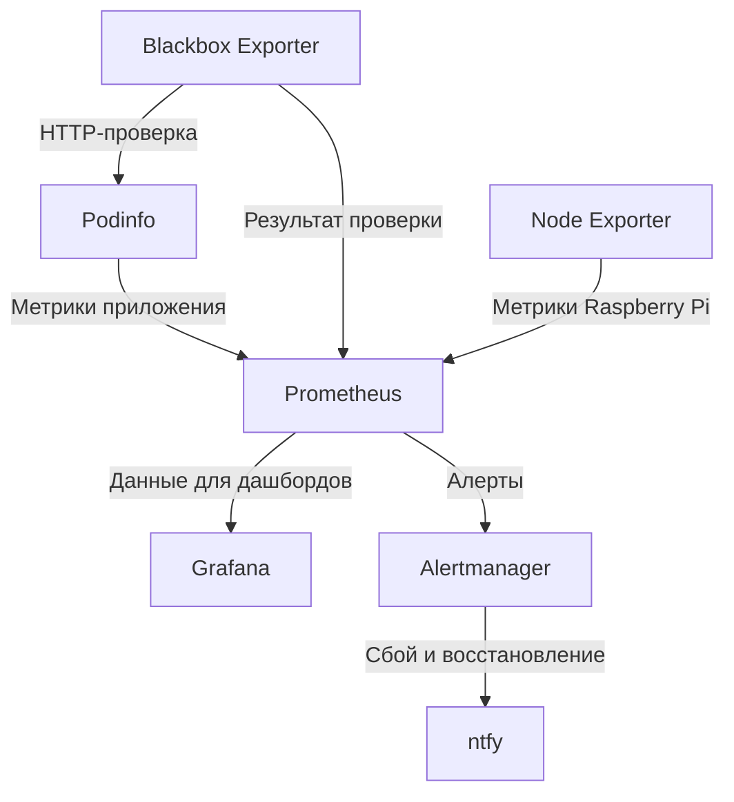

# PiOps

Учебный DevOps-проект на Raspberry Pi: доставка приложения через GitHub Actions, мониторинг приложения и хоста, уведомления о сбоях и восстановлении.

Цель — собрать и проверить на собственном сервере путь от изменения конфигурации в Git до работающего приложения с метриками, дашбордами и оповещениями. В качестве приложения используется готовый [Podinfo](https://github.com/stefanprodan/podinfo).

## Архитектура

Podinfo и компоненты мониторинга работают в Docker Compose. Node Exporter установлен на хосте как служба systemd. Интерфейсы Prometheus, Alertmanager и Grafana доступны через SSH-туннель.

GitHub Actions проверяет конфигурации. Доставка запускается вручную и после повторной проверки выполняется через self-hosted runner на Raspberry Pi.

## Стек

Окружение: **Raspberry Pi, AlmaLinux 9.8, ARM64**.

| Компонент | Назначение |
|---|---|
| Docker Compose | Запуск приложения и компонентов мониторинга |
| GitHub Actions | CI и ручной деплой на Raspberry Pi |
| Podinfo | Приложение с метриками и симуляцией HTTP-ошибок |
| Prometheus | Сбор и хранение метрик, вычисление правил алертов |
| Blackbox Exporter | Проверка доступности приложения по HTTP |
| Node Exporter | Метрики CPU, памяти, дисков и сети хоста |
| Alertmanager + ntfy | Доставка уведомлений о сбое и восстановлении |
| Grafana | Дашборды доступности приложения и состояния Pi |

Версии контейнерных образов закреплены в [compose.yaml](compose.yaml).

## Что реализовано

- **CI:** проверка Docker Compose и конфигураций Prometheus, Blackbox Exporter и Alertmanager.
- **Доставка:** ручной workflow с обязательным CI, применением конфигураций и проверкой готовности Prometheus и Alertmanager.
- **Мониторинг:** метрики Podinfo и Raspberry Pi, HTTP-пробы каждые 15 секунд.
- **Оповещения:** алерт при неуспешной HTTP-пробе в течение минуты; уведомления о сбое и восстановлении в ntfy.
- **Визуализация:** дашборд `HTTP_probe` с историей доступности и готовый `Node Exporter Full` для ресурсов хоста.
- **Хранение данных:** именованные Docker volumes для Prometheus, Alertmanager и Grafana.

## Результаты проверок

| Сценарий | Результат |
|---|---|
| Сбор метрик | Prometheus собирает показатели приложения и Raspberry Pi; HTTP-проверка подтверждает доступность Podinfo |
| Симуляция HTTP-сбоя Podinfo | Уведомления в ntfy получены через 90 и 92 секунды в двух ручных замерах |
| Восстановление приложения | Получено уведомление о восстановлении примерно через минуту |
| Пересоздание Prometheus и Grafana | Сохранились контрольная историческая точка метрики и оба дашборда с данными |

Замеры времени выполнены вручную и не являются гарантией задержки уведомлений. Проверка сохранения данных выполнена с прежними томами; восстановление из резервной копии не проверялось.

## Структура проекта

- [compose.yaml](compose.yaml) — сервисы, сеть и тома приложения и мониторинга.
- [monitoring/](monitoring/) — сбор метрик, HTTP-пробы, правило алерта и доставка уведомлений.
- [.github/workflows/](.github/workflows/) — CI и ручной деплой.
- [systemd/node_exporter.service](systemd/node_exporter.service) — системная служба Node Exporter.

## Известные ограничения

- HTTP-проба выполняется внутри Docker-сети и не проверяет доступность Raspberry Pi извне.
- Правило алерта обрабатывает неуспешную пробу, но не исчезновение её метрики.
- На текущем Pi недоступен memory controller cgroup, поэтому лимит памяти Prometheus не применяется.
